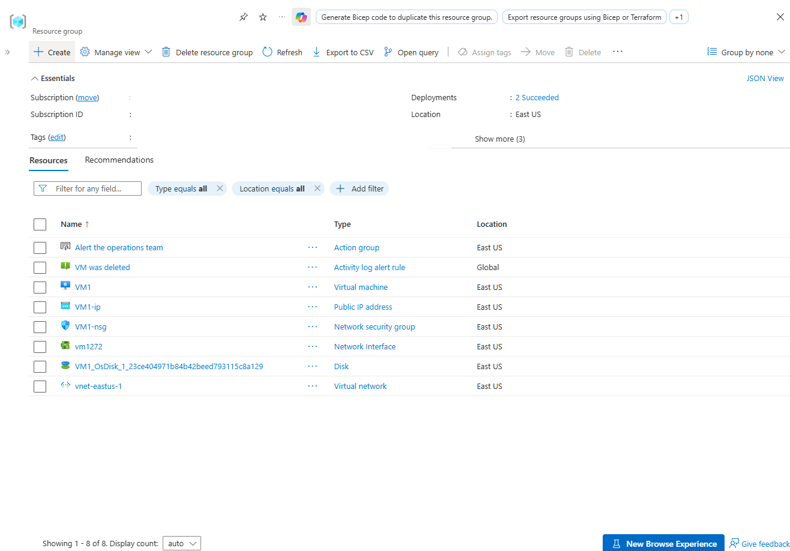
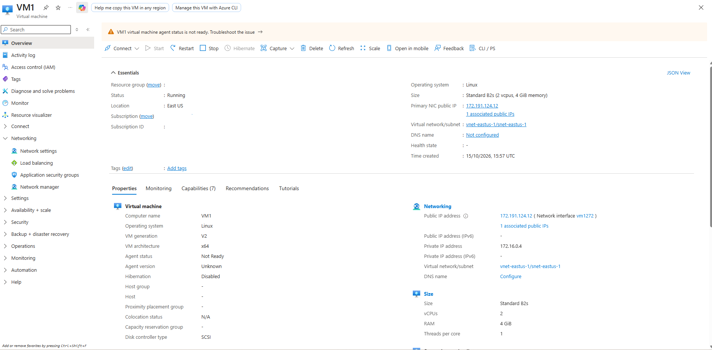
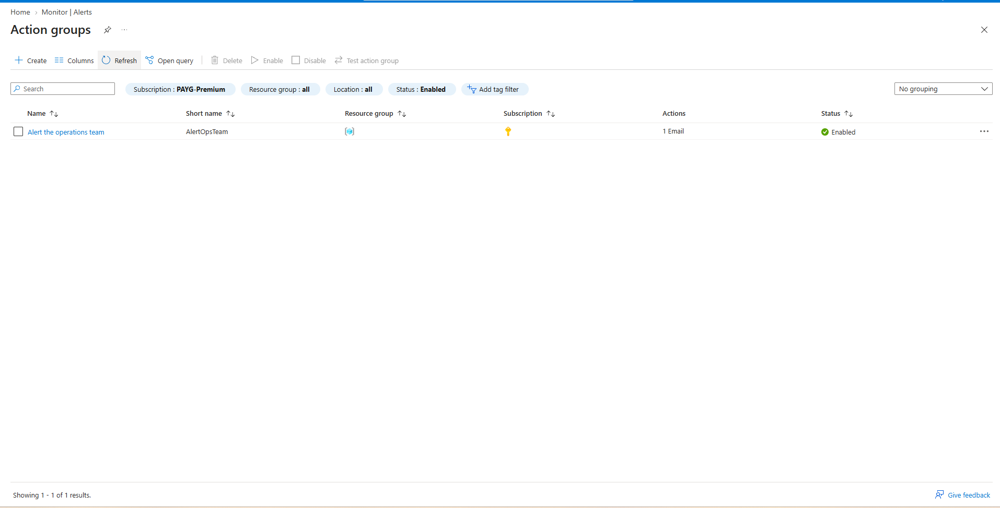
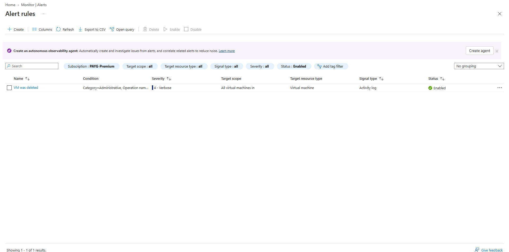
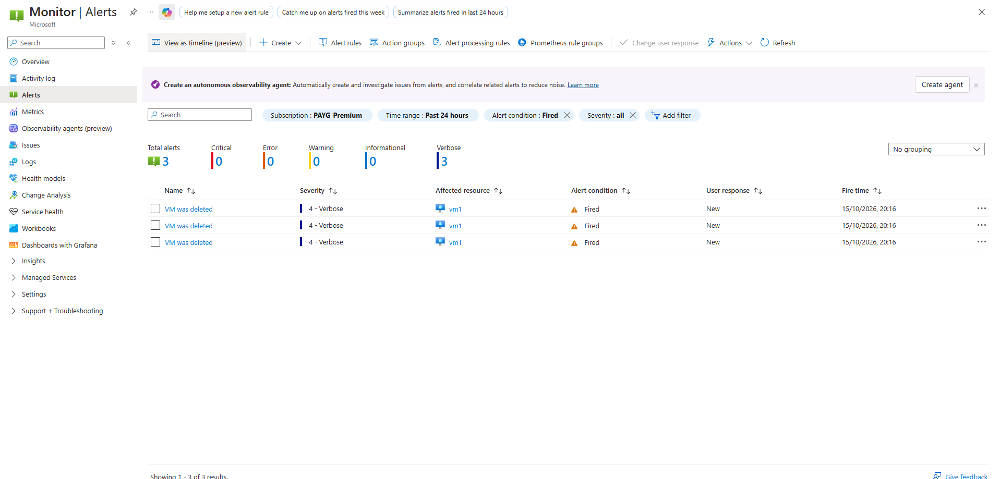
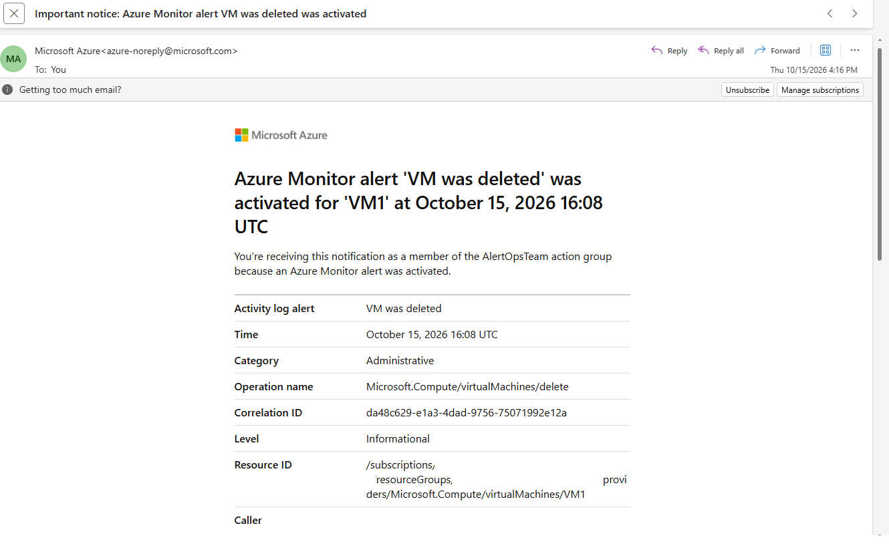

# Configuring Azure Activity Log Alerts and Action Groups for Infrastructure Monitoring

Comprehensive detailing the deployment of an Azure Activity Log Alert (`VM was deleted`) and an Action Group (`Alert the operations team`) in the East US region. The monitoring architecture detects administrative events regarding virtual machine deletions and automatically dispatches email notifications to designated operations teams.

---

## 1. Architecture & Provisioned Resources

### Core Infrastructure Topology

| Resource Type | Resource Name | Specification / Tier | Region / Location |
| :--- | :--- | :--- | :--- |
| **Activity Log Alert** | `VM was deleted` | Administrative scope tracking | Global (East US Scope) |
| **Action Group** | `Alert the operations team` | Email notifications (`AlertOpsTeam`) | East US |
| **Virtual Machine** | `VM1` | Standard B2s, Ubuntu 24.04 LTS | East US |
| **Virtual Network** | `vnet-eastus-1` | Address Space: `172.16.0.0/16` | East US |
| **Subnet** | `snet-eastus-1` | Address Prefix: `172.16.0.0/24` | East US |
| **Network Security Group** | `VM1-nsg` | Standard Network Security Group | East US |
| **Public IP Address** | `VM1-ip` | Static Standard IPv4 (`172.191.124.12`) | East US |

---

### Provisioned Environment Validation

*Resource group overview confirming successful provisioning of the Action Group, Activity Log Alert rule, virtual machine, public IP, network interface, network security group, and virtual network.*

---

## 2. Step-by-Step Implementation

### Step 1: Inspect Virtual Network Configuration

Reviewed the core virtual network (`vnet-eastus-1`) layout and subnet allocations designed to support target compute resources.

* **Virtual Network:** `vnet-eastus-1`
* **Address Space:** `172.16.0.0/16`
* **Subnet:** `snet-eastus-1` (`172.16.0.0/24`)

*Reviewing essentials, operating system (Ubuntu Linux), and network interface bindings for VM1.*

---

### Step 2: Configure Action Groups for Notifications

Created and inspected the Action Group (`Alert the operations team`) configured to handle alert dispatches and recipient communication channels.

* **Action Group Name:** `Alert the operations team`
* **Short Name:** `AlertOpsTeam`
* **Receiver Type:** Email (`osama.aljishi@hotmail.com`)

*Reviewing action group configuration, notification channels, and operational status.*

---

### Step 3: Create and Configure Activity Log Alert Rules

Configured the Azure Monitor Activity Log Alert rule to target administrative operations and trigger upon specific resource deletion events.

* **Alert Rule Name:** `VM was deleted`
* **Signal Type:** Activity Log
* **Condition:** Category = `Administrative`, Operation Name = `Microsoft.Compute/virtualMachines/delete`
* **Severity Level:** 4 - Verbose

*Reviewing alert rule conditions, scope settings, and associated action linkages.*

---

### Step 4: Monitor Fired Alerts and Trigger History

Inspected the Azure Monitor Alerts dashboard to track active alerts, event firing frequency, and severity classifications across the subscription.

* **Total Alerts Tracked:** 3 Fired Events (Severity Level 4 - Verbose)
* **Affected Resource:** `VM1`
* **Condition Status:** Fired

*Monitoring active alert firing history and affected resource metrics in Azure Monitor.*

---

### Step 5: Validate Automated Notification Delivery

Verified successful email dispatch and receipt confirming that the notification system correctly transmitted alert details upon rule activation.

* **Notification Subject:** `Important notice: Azure Monitor alert VM was deleted was activated`
* **Trigger Timestamp:** October 15, 2026 16:08 UTC
* **Operation Details:** `Microsoft.Compute/virtualMachines/delete` for resource `VM1`

*Reviewing the email notification received from Azure Monitor detailing the virtual machine deletion event.*
